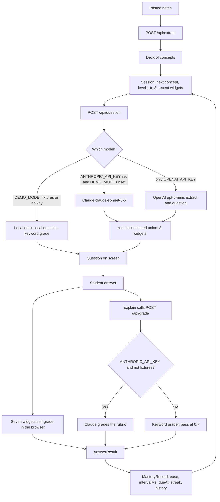

# Recall

Active recall, instead of flipping flashcards. Paste notes, and each question arrives as an interactive widget chosen for the concept and for how well you know it.

**Live app:** TODO. No public URL yet. Publish from the Cursor Apps tray (or import the repo in Vercel). The hackathon track needs a public link with no login wall.

**Slideshow:** TODO. Public Google Slides, Canva, or PDF link is not created yet.

**Repo:** https://github.com/bmealey2005/Grokbot-Hackathon (public)

## Screenshots

TODO. Add 2 or 3 real screenshots after the study flow is on `main`. Do not commit mockups labeled as product shots.

1. TODO: pasted notes turning into concepts
2. TODO: one question widget during a session
3. TODO: mastery map on the results page

Quizlet comparison shots belong in [`docs/teardown/`](docs/teardown/README.md). They are not captured yet.

`public/og.svg` is a 1200×630 wordmark with the home-page tagline. `src/app/layout.tsx` does not point `openGraph.images` at it. That file belongs to Agent 2.

## Inspiration

Recognition and recall are different skills. A flashcard that shows the term and asks you to flip for the definition mostly tests whether the answer looks familiar. Students can pass that check and still blank on a test, because the test asks them to produce the idea.

Recall is built so the question changes shape as mastery changes. A concept starts as recognition (pick the right option, judge a statement), moves to recall (fill the blank, type the term, match pairs), and then to application (order a process, estimate a value, explain it in your own words). Weak concepts come back later, in a new format, instead of cycling the same card.

Student quotes about how people study today are TODO. None have been collected yet. See [`docs/teardown/`](docs/teardown/README.md).

## What it does

The intended session, as specified by the shared contract in `src/lib/schema.ts`:

1. The student pastes notes. `POST /api/extract` with `{ text, title? }` returns `{ deck }`. A deck has an id, a title, a timestamp, and concepts. Each concept has a term, a definition, supporting facts, and ids of related concepts.
2. The session picks a concept and a level. Levels are `1` recognize, `2` recall, and `3` apply.
3. `POST /api/question` receives the concept, neighbor concepts, the level, and the recent widget names. The model must return a `QuestionEnvelope`: concept ids, a level, and a `WidgetSpec`.
4. The widget registry renders that spec. Seven widgets grade themselves in the browser and call `onSubmit` with an `AnswerResult`. The `explain` widget is graded by `POST /api/grade`, which returns the same `AnswerResult` shape, including any missed rubric points.
5. The result updates a `MasteryRecord` (level, SM-2-style `ease`, `intervalMs`, `dueAt`, streak, and a history of score plus widget). Due concepts return later.

The eight widgets (`spec.widget`):

| Widget | What the student does | Grading |
| --- | --- | --- |
| `multipleChoice` | Pick one of 3–5 options | In the widget |
| `trueFalse` | Judge a statement | In the widget |
| `cloze` | Fill `{{blank}}` markers | In the widget |
| `typeAnswer` | Type a short answer against an accepted list | In the widget |
| `matchPairs` | Match 3–6 pairs | In the widget |
| `orderSteps` | Put steps in order. The spec lists them correctly; the UI shuffles | In the widget |
| `slider` | Choose a number inside a min/max, within a tolerance | In the widget |
| `explain` | Write an explanation against a rubric | `POST /api/grade` |

**What `main` runs today** (`abc00bb`, through [PR #4](https://github.com/bmealey2005/Grokbot-Hackathon/pull/4)):

- Home renders `RecallLibrary`. `/study/[deckId]` renders `RecallStudy`. `/results/[deckId]` renders `RecallResults`. Those screens came in with the merged preview, [PR #2](https://github.com/bmealey2005/Grokbot-Hackathon/pull/2). `src/widgets/registry.tsx` is still the stub that submits a score of 0. The eight widget components are in draft [PR #5](https://github.com/bmealey2005/Grokbot-Hackathon/pull/5) and are not on `main`.
- The session engine is in. `useSession(deckId)` from `@/lib/useSession` returns `{ current, submit, progress, isLoading }`. `current` is `{ envelope, concept, level }` or `null`. `submit(result)` takes an `AnswerResult`. `progress` is `{ answered, correct, conceptCount, percent, byConcept }`. `isLoading` is true while the next question is in flight. The question after the one on screen is prefetched.
- `useRecallStore` persists `{ decks, mastery }` to `localStorage` under the key `recall-store`. Unreadable or invalid saves are dropped. `loadSampleDeck()` inserts `cell-biology-basics`. `useSession("cell-biology-basics")` loads that deck on its own.
- The scheduler promotes at score `>= 0.8` (level max 3, ease `+0.1`, cap 3.0). Intervals step 1 minute, 10 minutes, 1 day, 3 days, then interval × ease, capped at 30 days. A score below `0.5` demotes (level min 1, ease `−0.2`, floor 1.3) and resets the interval to 1 minute when it was in-session, or 10 minutes when it had been scheduled further out. Scores in between keep the level and stretch the interval by 1.2. `masteryPercent` weights level, the last five scores, and streak, and returns 0–100.
- The session asks the most overdue concept, or the weakest when nothing is due. It skips the concept just asked when the deck has another one. `recentWidgets` is the last six widget names. If `/api/question` returns a payload that fails validation, the runner falls back to a local `typeAnswer` ("What is {term}?") accepted as the term itself.
- `POST /api/extract` reads notes up to 20,000 characters. `DEMO_MODE=fixtures`, or a missing `ANTHROPIC_API_KEY`, builds a deck locally: Quizlet rows (`term<TAB>definition` or `term - definition`) when the paste matches, otherwise the local reader. With `ANTHROPIC_API_KEY` set and demo mode unset, a Quizlet paste is parsed locally and Claude may add facts that appear in the source. Other notes go to Claude for 5–25 concepts. A model failure falls back to the local deck. If there is no Anthropic key, demo mode is unset, and `OPENAI_API_KEY` is set, extract tries OpenAI `gpt-5-mini` and otherwise stays local.
- `POST /api/question` asks Claude for one of the eight widgets when `ANTHROPIC_API_KEY` is set and `DEMO_MODE` is not `fixtures`. zod and the server checks reject a bad spec. The call retries once. If that fails, or if there is no Anthropic key, the route returns a local question, then a `typeAnswer` ("What term matches: {definition}?"). The same OpenAI fallback as extract applies when only `OPENAI_API_KEY` is set.
- `POST /api/grade` sends the free-text answer to Claude when `ANTHROPIC_API_KEY` is set and demo mode is unset. `correct` is `score >= 0.7`. A model failure, a missing key, or `DEMO_MODE=fixtures` uses the keyword grader at that same 0.7 line. Grade does not call OpenAI.
- `src/lib/aiClient.ts` validates responses, retries once, and throws `StudyClientError` with a message the UI can show.
- The model is Claude, not xAI Grok. Nothing on `main` reads `XAI_API_KEY`.

Cell Biology Basics is still the sample deck in `src/fixtures/`. [PR #4](https://github.com/bmealey2005/Grokbot-Hackathon/pull/4) added an Intro CS deck and the route tests. On that pull request, `npm test` passed with 59 tests and `npm run build` passed before the merge.

## How we built it (tech stack)

Declared in `package.json` on `main`:

- Next.js 16.4.6, App Router, React 19.3.0, TypeScript 5
- Tailwind CSS 4.3.3 (`@tailwindcss/turbopack` for CSS in `next.config.ts`)
- Framer Motion 14 and `@dnd-kit` (core, sortable, utilities) for widget motion and reordering
- zod 4 for the shared contract and for request validation on the API routes
- Zustand 5, persisting decks and mastery to `localStorage` (`recall-store`)
- Vitest 5 with Testing Library and jsdom
- `@openai/apps-sdk-ui` 0.2, used by the screens merged in PR #2
- Claude Sonnet 5.5, model id `claude-sonnet-5-5`, through `https://api.anthropic.com/v1/messages`. The server reads `ANTHROPIC_API_KEY`. This is the model the app keeps. It does not call the xAI Grok API.
- Optional OpenAI fallback, model `gpt-5-mini`, through `https://api.openai.com/v1/responses`, only for `POST /api/extract` and `POST /api/question`, and only when `ANTHROPIC_API_KEY` is unset, `OPENAI_API_KEY` is set, and `DEMO_MODE` is not `fixtures`

`next.config.ts` sets `cacheComponents` and `partialPrefetching`. No `vercel.json` is checked in. Next.js detects this app from the `build` and `start` scripts, and the deploying guide does not require a `vercel.json` for a Node server deploy.

Generative UI stays inside a closed set. The model is asked for JSON. zod's discriminated union accepts only the eight widgets. Anything else fails validation before it reaches the registry, so the page cannot render an arbitrary component the model invented.



On `main`, the session and mastery boxes are the engine from PR #1. Extract, question, and grade call Claude when `ANTHROPIC_API_KEY` is set and `DEMO_MODE` is not `fixtures`. The per-widget registry file is still the stub. Draft PR #5 is the widget UI that is not merged yet.

## Challenges we ran into

Agent 1's merged pull request ([#1](https://github.com/bmealey2005/Grokbot-Hackathon/pull/1)) has a summary and scoring notes, and no separate "challenges" list.

[PR #4](https://github.com/bmealey2005/Grokbot-Hackathon/pull/4) reports one challenge: a bad widget could break the study loop, so the question route retries once and then serves a local question.

TODO:

- Agent 2 challenges. Draft [PR #5](https://github.com/bmealey2005/Grokbot-Hackathon/pull/5) is open and not merged.
- Measured Quizlet step counts, ads, and paywall notes: see [`docs/teardown/`](docs/teardown/README.md)

The app stays on Claude. `main` does not call xAI, and `XAI_API_KEY` is not a variable the routes read. `.env.example` on `main` lists `ANTHROPIC_API_KEY`, optional `OPENAI_API_KEY`, and `DEMO_MODE`.

Cursor's Apps publish step is a person clicking Publish in the preview tray. This agent has no publish tool and no Vercel token, so it cannot set `ANTHROPIC_API_KEY`. The host has to.

## Accomplishments that we're proud of

From `main` after the scaffold and PR #1:

- One shared zod contract for decks, the eight widgets, question envelopes, answer results, mastery records, and the three API bodies. A widget name outside that union fails `WidgetSpec` parsing. The fixture tests cover that case with `"diagram"`.
- A stable sample deck, Cell Biology Basics, with 12 concepts whose `related` ids all point at other concepts in the deck.
- One fixture spec for every widget, plus stub routes that validate input and return those fixtures.
- A session loop with prefetch, a spaced-repetition scheduler, and a Zustand store that recovers from a corrupt `localStorage` save. `useSession()` is the hook the study screen renders against.
- Extract, question, and grade on Claude Sonnet 5.5, with `DEMO_MODE=fixtures` for a no-key run and an optional OpenAI `gpt-5-mini` path for extract and question.
- The GitHub repo is public: https://github.com/bmealey2005/Grokbot-Hackathon

TODO: the on-screen study loop, the live phone pass, and the notes from Agents 2 and 3.

## What we learned

TODO. This section waits on the other agents' "Notes for README" and on the scrubbed session export. No lesson is filled in here, because none has been reported yet.

## What's next

Planned after the hackathon, from the project brief. None of these are in the repo.

- Accounts and sync across devices
- A diagram-labeling widget
- A "teach it back" mode
- Quizlet URL import
- Classes

Also still open for this submission: a public live link, screenshots, the slideshow, the scrubbed session export, a phone rehearsal, and the Typeform submission. The human checklist is in the docs linked below.

## How Grok Bot helped build it

The work is split across four cloud agents so the contract, the interface, the model routes, and the submission can move in parallel:

| Agent | Branch | Owns |
| --- | --- | --- |
| 1 Core | `agent-1-core`, after the scaffold landed on `main` | `src/lib/schema.ts` (frozen), scheduler, session, store, `useSession()` |
| 2 Interface | Agent 2's branch | `src/components`, `src/widgets`, `src/app` pages |
| 3 Model | Agent 3's branch | `src/app/api/*`, `src/lib/aiClient.ts`, `src/fixtures` |
| 4 Ship | `agent-4-ship` | This README, `docs/**`, `public/**`, deploy config |

Agent 1's scaffold commit is `0873478`. The session engine landed in [PR #1](https://github.com/bmealey2005/Grokbot-Hackathon/pull/1). [PR #2](https://github.com/bmealey2005/Grokbot-Hackathon/pull/2) merged the preview screens. [PR #4](https://github.com/bmealey2005/Grokbot-Hackathon/pull/4) merged the Claude routes. `main` is that merge, `abc00bb`. Agent 2's interface is draft [PR #5](https://github.com/bmealey2005/Grokbot-Hackathon/pull/5) (`agent-2-ui`) and is not merged.

Session export: TODO. Teammate Grok Bot transcripts are not in the repo. The scrub checklist is [`docs/session-export/README.md`](docs/session-export/README.md). Link the scrubbed files from this section after a second teammate has checked them. Do not commit names, emails, phone numbers, or tokens.

## How to run it

```bash
npm i
cp .env.example .env.local
npm run dev
```

Open the URL Next prints (the scaffold uses the default Next dev port).

```bash
npm test
npm run build
```

`npm test` runs Vitest once. `npm run build` runs `next build`.

`.env.example` on `main` lists `ANTHROPIC_API_KEY`, `OPENAI_API_KEY`, and `DEMO_MODE`. Copy it before filling in a key. Never commit `.env.local`.

**No-key run.** Set `DEMO_MODE=fixtures`. Extract builds a local deck, question serves a local widget, and grade uses the keyword check. Claude and OpenAI are not called.

```bash
DEMO_MODE=fixtures npm run dev
```

**Live model.** Leave `DEMO_MODE` empty and set `ANTHROPIC_API_KEY`. Extract, question, and grade then call Claude Sonnet 5.5 (`claude-sonnet-5-5`). Optional `OPENAI_API_KEY` is used only when the Anthropic key is absent: extract and question call `gpt-5-mini`, and grade stays on the keyword fallback.

**Where `ANTHROPIC_API_KEY` has to be set.** A person sets it on the host. This agent cannot.

- Local: `.env.local`.
- Cursor Apps: the app's Secrets section in the [Apps dashboard](https://cursor.com/docs/cloud-agent/apps). Add a secret named `ANTHROPIC_API_KEY`. The agent never sees the value. Leave `DEMO_MODE` empty when that key is present. Public sharing has to be on, or the link sits behind Cursor sign-in and fails the "no login wall" rule.
- Vercel, if the repo is imported there: Project Settings, Environment Variables, `ANTHROPIC_API_KEY` for Production. Add `OPENAI_API_KEY` only if that fallback should run. No `vercel.json` is required for this Next.js app.

After a deploy exists, confirm it from the host's dashboard. This branch does not have a live URL to check.
